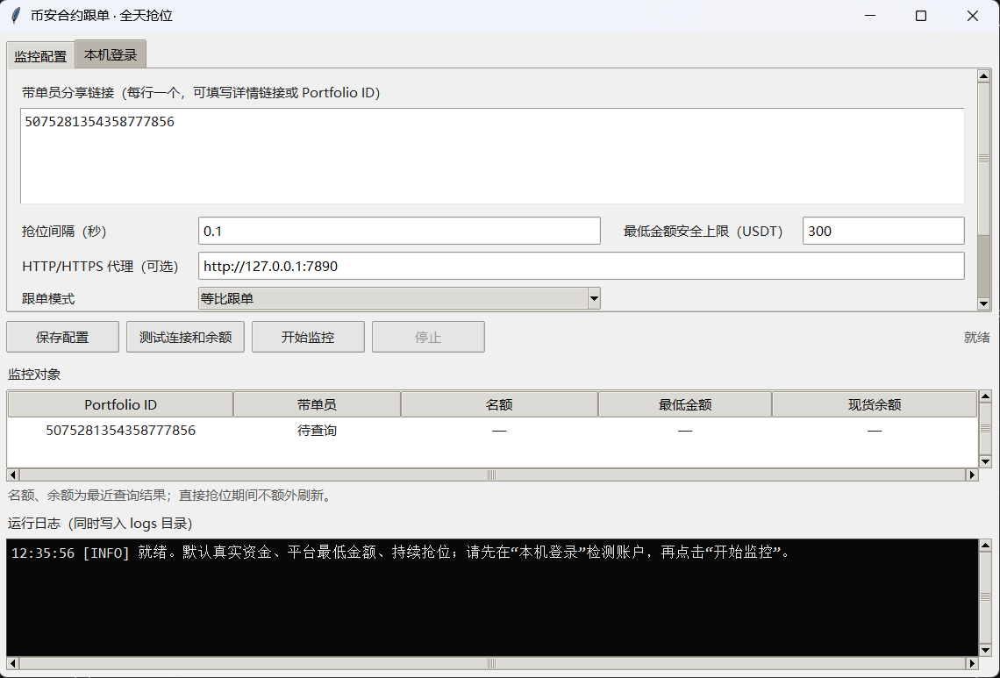

# 币安合约跟单 · 全天抢位

Windows 桌面工具，用于监控币安合约带单组合，在满足条件时自动申请加入。支持专用 Edge 登录、多目标、持续重试、结果核对和成功提示。

**默认启用真实资金自动加入和直接抢位。打开程序、登录或测试连接不会提交跟单；点击「开始监控」后才会执行。** 默认按平台最低金额投入，杠杆和保证金模式跟随带单员。

[下载 Windows 程序](https://github.com/Nagnip-xu/binance-copy-monitor/releases/latest) · [版本记录](https://github.com/Nagnip-xu/binance-copy-monitor/releases)

[打开项目官网](https://nagnip-xu.github.io/binance-copy-monitor/) · [查看源代码](https://github.com/Nagnip-xu/binance-copy-monitor)

这是个人开发的工具，与币安官方无隶属关系。使用网页内部接口，接口和登录规则可能变化；无法保证抢到空位或永久保持登录。合约跟单使用真实资产，可能产生亏损。

项目官网是纯静态介绍页，只展示功能、脱敏界面和使用说明；网页不会登录币安、读取 Cookie 或发起跟单。

## 项目官网

直接访问 **[https://nagnip-xu.github.io/binance-copy-monitor/](https://nagnip-xu.github.io/binance-copy-monitor/)**，无需启动本地预览服务。官网提供三种运行方式的交互演示、真实软件界面、使用步骤、常见问题及 Windows 下载入口；演示不连接真实账户。

官网源码位于 [`site/`](site/)，采用纯 HTML/CSS/JavaScript，包含自托管字体与许可。本地预览：

```powershell
python -m http.server 8765 --bind 127.0.0.1 --directory site
```

打开 `http://127.0.0.1:8765/` 即可查看。GitHub Pages 使用 [Deploy website](.github/workflows/pages.yml) 工作流，只发布 `site/`：向 `main` 推送网站目录或该工作流的修改后自动更新，也可在仓库 Actions 页面手动运行。发布状态见 [Actions](https://github.com/Nagnip-xu/binance-copy-monitor/actions/workflows/pages.yml)。

## 界面预览



截图为未查询账户的界面示意，组合 ID 为公开信息，不包含实际余额或登录凭据。截图来自增加拖动条前的界面；当前版本可拖动「监控对象」与「运行日志」之间的灰色分隔条，上下调整空间。

## 功能

- 只保留「监控配置」「本机登录」两个页签。
- 在程序打开的专用 Edge 窗口中登录，不装扩展、不必手动寻找 Cookie。
- 最多配置 20 个公开带单链接或 Portfolio ID，持续运行至全部目标确认加入，或手动停止。
- 支持直接循环申请加入、先查空位再自动加入，以及关闭真实资金后仅监控空位。
- 表格显示带单员、名额、最低金额和最近查询的现货余额；黑底日志显示实际提交数和核对进度。
- 新申请经账户状态确认成功后弹出提示，显示目标、模式和本次投入。
- 本地保留提交记录；结果不明时暂停新申请，重启后继续核对，避免重复投入。

## 安装与启动

### 方式一：下载 EXE

1. 从 [Releases](https://github.com/Nagnip-xu/binance-copy-monitor/releases/latest) 下载 `BinanceCopyMonitor.exe`，放入有写入权限的独立文件夹。
2. 电脑需要安装 Microsoft Edge。EXE 已包含 Python 运行组件，无须另装 Python。
3. 双击运行。首次运行会在程序旁生成 `data/`、`logs/`。

升级时先停止监控并退出，再替换同一文件夹内的 EXE，保留原来的 `data/`。不要用新目录绕过尚未确认的提交记录。

### 方式二：从源码运行

要求：Windows、带 Tcl/Tk 的 Python 3.11+、Microsoft Edge。

```powershell
git clone https://github.com/Nagnip-xu/binance-copy-monitor.git
cd binance-copy-monitor
py -3 -m venv .venv
.\.venv\Scripts\python.exe -m pip install --upgrade pip
.\.venv\Scripts\python.exe -m pip install -e .
.\.venv\Scripts\python.exe -m binance_monitor
```

程序通过 Playwright 使用本机 Edge，不需要执行 `playwright install chromium`。`start.bat` 优先运行同目录 EXE，否则调用系统 Python；使用虚拟环境时建议采用上面的完整命令。

## 登录与开始监控

1. 如需代理，在「监控配置」填写本地 HTTP 代理，例如 `http://127.0.0.1:7890`。留空可直连；首次配置会尝试检测系统本地代理。
2. 切换到「本机登录」，点击「打开 Edge 登录」。在新开的专用窗口中完成币安登录和验证。
3. 返回程序点击「检测账户」。检测只查询，不创建跟单；运行期间保持专用 Edge 打开。
4. 在「监控配置」填写带单链接或 Portfolio ID，每行一个，选择间隔、金额上限和跟单模式。
5. 点击「测试连接和余额」，确认网络、目标和余额可读取。跟单使用可用现货 USDT，需要自行准备足够资金。
6. 核对真实资金及直接抢位选项，点击「保存配置」，再点击「开始监控」。
7. 在下方表格和日志查看进度；需要中断时点击「停止」。新申请确认成功后弹出提示，全部目标完成后停止。

**普通 Edge 中已登录，并不代表程序的专用 Edge 已登录。** 两者使用独立配置；首次需要在专用窗口重新登录，以后由 Edge 保留登录状态。程序不要求在聊天中提供密码、Cookie 或 API 密钥。

## 参数说明

| 参数 | 含义 |
| --- | --- |
| 带单员分享链接 | 官方 HTTPS 详情链接或纯数字 Portfolio ID；每行一个，最多 20 个 |
| 抢位间隔（秒） | 允许 0.1–300 秒，默认 0.1；所有目标串行、共用间隔 |
| 最低金额安全上限（USDT） | 单个组合允许投入的平台最低金额上限，默认 300；超过上限不加入 |
| HTTP/HTTPS 代理 | 本地 HTTP 代理地址，可留空；不支持在地址中填写账号密码 |
| 跟单模式 | 默认等比跟单；可选定额跟单，每笔保证金固定为 10 USDT |
| 真实资金自动加入 | 默认勾选；取消后只监控空位，不提交跟单 |
| 直接抢加入 | 默认勾选；启动检查后直接循环申请加入，不再轮询公开空位 |

**金额上限不是固定投入金额。** 例如上限为 300 USDT：平台最低是 100，就申请投入 100；最低是 500，就不加入。多个目标分别占用资金，300 不是所有目标的合计预算。

投入方式固定为平台最低金额，杠杆和保证金模式跟随带单员。不提供自定义杠杆、止盈止损、累计预算、次数或时长设置。定额模式的「每笔 10 USDT」是复制交易时的每笔保证金，与加入组合时的平台最低投入不同；定额模式尚未完成实盘验证。

代理订阅链接不能直接填入代理栏。请先让代理客户端运行，再填写它提供的本地 HTTP 监听地址。

## 三种运行方式

| 真实资金 | 直接抢加入 | 实际行为 |
| --- | --- | --- |
| 勾选 | 勾选 | 启动核验账号、详情、最低金额和余额，之后循环创建；明确满员时继续重试 |
| 勾选 | 取消 | 查询公开空位；有空位时复核账号、详情和余额，再自动申请加入 |
| 取消 | 任意 | 只监控空位，不提交跟单 |

直接模式只对明确的满员拒绝（`11012017`）持续重试，没有总时长或次数上限。登录失效、账号变化、余额不足、验证或未知拒绝等会停止并记录原因，不会把所有错误都当成满员。

### 0.1 秒是否代表每秒抢 10 次？

不代表。请求串行执行，还需要等待平台响应、账号核验和网络传输；实际频率受这些耗时影响，多个目标也共用间隔。发生限流时遵循平台冷却时间，短暂查询故障会自动退避。

正常结果核对也使用设置的间隔，不会因为连续查不到成功而自动改成 2、5、10、30 秒。只有请求故障或限流才增加等待；有效响应后恢复所设间隔。

## 监控对象与运行日志

表格显示最近一次实际查询结果，未查到的字段显示「待查询」或「未知」。直接抢位的名额标注「启动」，表示启动快照；不会为了刷新表格额外增加请求。最近查询的余额也不等同于持续实时余额。

拖动表格与日志之间的灰色分隔条：向上拖扩大日志，向下拖扩大表格。两块区域均保留最小可见高度；调整在本次运行中保留，不跨启动保存。上方设置内容较多时可滚动。

| 日志或状态 | 含义 |
| --- | --- |
| 直接抢位中、已提交 N 次 | 正在申请加入；N 是实际累计提交次数 |
| 项目已满、`11012017` | 这次申请被明确拒绝为满员，仍会继续重试 |
| 查询重试、网络恢复中 | 查询发生短暂故障，等待后自动恢复 |
| 结果核对中、不重复提交 | 上次创建结果尚不明确，暂停所有新创建，只查询原申请结果 |
| 官方尚未显示已跟单、抢位已暂停 | 尚未确认原申请成功；此时不会因出现空位而再发一笔申请 |
| 已成功加入 | 新申请已由账户跟单状态再次确认成功 |
| ERROR | 阻断错误，按具体原因检查账号、余额、网络或平台验证 |

直接抢位日志约每 30 秒汇总提交数和最近拒绝，首次满员和停止时也会记录；**这不表示每 30 秒才申请一次。** 结果核对每次查询结束立即写入进度，显示本轮次数、最近结果和下次等待；右侧显示倒计时或当前查询用时。

成功弹窗显示本次记录的实际投入和模式，不阻塞其他目标。原本就已跟单的目标会跳过，避免重复投入。

## 为什么结果不明时暂停抢位

创建请求超时并不等于失败：平台可能已经收到并执行。此时再次创建可能重复投入。因此，程序先持久保存提交记录，再发起请求；收到不确定结果后保持锁定，持续只读核对。

```mermaid
flowchart TD
    A[点击开始监控] --> B[核验账号、目标和资金]
    B --> C[直接申请或等待空位后申请]
    C --> D{创建结果}
    D -->|明确满员| E[按间隔等待]
    E --> C
    D -->|已受理或结果不明| F[暂停新申请，只读核对]
    F -->|尚未确认| F
    F -->|确认已跟单| G[记录成功并提示]
    G --> H[继续其他目标，全部完成后停止]
    D -->|其他阻断错误| I[停止并显示原因]
```



余额没变或官方暂时返回 `hasCopy=false`，都不足以证明原请求失败。点击停止也不能撤回已经发出的请求。

### 停止、重启和长期未确认

- 停止或退出后，未确认记录继续保留；重新使用原账号登录并点击「开始监控」，会先接着核对原记录。
- 有未确认记录时，日志标题旁显示「核对未确认记录」。停止监控后，可在这里仅查询官方状态。
- 若长期没有结果，需要先自行在官方「我的跟单」和资产流水确认未创建、无此次扣款，且原请求已结束，再选择「确认未创建并解除锁定」。程序还会重新核验账号、记录和官方状态；若已经加入，会记录成功。
- 解除后不会自动发单，需要再次点击「开始监控」。不要通过删除数据库、复制到新目录或删除锁文件恢复抢位。

## 全天候运行与服务器

程序没有抢位时长限制。监控期间默认向 Windows 请求防止自动休眠，停止后释放，不修改系统电源方案。

全天运行需要保持电脑接电、程序和专用 Edge 打开、登录有效、网络和代理稳定。屏幕可以熄灭；手动睡眠、合盖、关机、重启会打断运行。当前没有开机自动登录、自动恢复真实资金监控或保证永不掉线的功能。

可以使用有图形桌面、Microsoft Edge 和稳定网络的 Windows 服务器，仍需完成专用 Edge 登录，并自行维护系统运行状态。当前不是 Linux 无头服务，没有提供 Docker 或 systemd 部署；命令行 `--headless` 只用于公开信息检查或离线演示，不支持无头自动跟单。

## 常见问题

**普通浏览器能打开，程序却连不上？**

检查代理客户端是否运行、HTTP 端口是否正确。代理订阅链接不是本地 HTTP 代理。修改代理后重新打开专用 Edge 并检测账户。

**提示未登录、检测失败或账号发生变化？**

先停止监控，在专用 Edge 完成登录和验证，再检测账户。若有未确认记录，应使用发出原申请的账号继续核对；不要切换账号绕过锁定。

**有空位为什么没有继续抢？**

先看状态。处于「结果核对中」时只确认原申请，不再创建；其他可能原因包括最低金额超过上限、余额不足、平台验证或程序已停止。公开页面也可能存在更新延迟。

**是否还要手动导入 Cookie？**

正常使用不需要，推荐专用 Edge 登录。「本机登录」保留高级手动导入，供兼容问题排查使用；可导入本人浏览器复制的最新只读余额请求。内容按数据解析，不会作为 Shell 命令执行；可选用 Windows DPAPI 加密保存。不要把 Cookie 或完整请求提交到 GitHub。

**更新会丢配置或再次投入吗？**

在同一文件夹替换 EXE，并保留 `data/`。记录用于识别已加入和未确认提交；升级前先停止并退出，升级后检查配置、账号，再手动开始。

## 本地数据与隐私

| 路径 | 用途 |
| --- | --- |
| `data/config.json` | 监控参数及高级导入的只读余额查询配置 |
| `data/edge-profile/` | 专用 Edge 配置及本地登录状态 |
| `data/session.dpapi` | 可选的高级导入会话，Windows 当前用户加密保存 |
| `data/joins.sqlite3` | 成功、预留和未确认提交记录 |
| `data/joins.runlock` | 避免多进程同时提交的运行锁 |
| `logs/monitor.log` | 轮转运行日志；旧版日志可能位于 `data/monitor.log` |

`data/`、`logs/` 被 Git 忽略，不随源码发布。专用 Edge 的登录由本地浏览器管理，程序不读取普通 Edge 的凭据库。提交记录绑定账号标识的哈希，日志不输出原始私有响应、Cookie 或账号 UID；本地浏览器配置仍属于敏感数据，应妥善保存。

## 开发、验证与打包

```powershell
# 离线测试，不提交真实跟单
.\.venv\Scripts\python.exe -m unittest discover -s tests -q

# 离线桌面演示；数据与真实记录隔离
.\.venv\Scripts\python.exe -m binance_monitor --demo

# 离线命令行演示
.\.venv\Scripts\python.exe -m binance_monitor --demo --headless

# 仅查询公开信息，不使用私有账户或创建跟单
.\.venv\Scripts\python.exe -m binance_monitor --check 5075281354358777856 --proxy http://127.0.0.1:7890

# 打包 Windows 单文件程序
.\.venv\Scripts\python.exe -m pip install pyinstaller
.\.venv\Scripts\python.exe -m PyInstaller --noconfirm --clean --onefile --windowed --distpath . --name BinanceCopyMonitor launcher.py
```

`demo.bat` 启动离线桌面演示；`build.bat` 用当前系统 Python 执行相同打包流程。EXE 通过 Release 附件发布，不放入 Git 源码历史。发布文件提供 SHA-256 校验值。

测试覆盖参数校验、公开响应解析、导入解析、账户绑定、满员重试、网络退避、提交记录、结果恢复、成功提示及表格行为。离线测试通过不能代表网页接口永远兼容，也不能代替实盘验证。

```text
binance-copy-monitor/
├── binance_monitor/       # 桌面界面、登录、监控、创建与核对
├── tests/                # 离线测试与公开数据样例
├── docs/images/          # README 界面图片
├── site/                 # GitHub Pages 官网与静态资源
├── .github/workflows/    # 官网自动部署
├── launcher.py           # EXE 打包入口
├── pyproject.toml        # Python 依赖与包配置
├── start.bat             # 正常启动
├── demo.bat              # 离线演示
├── build.bat             # 本地打包
└── README.md
```

提交 Issue 时请附程序版本、脱敏错误和复现步骤；不要上传登录状态、完整 cURL、Cookie、代理订阅或私人资产信息。
